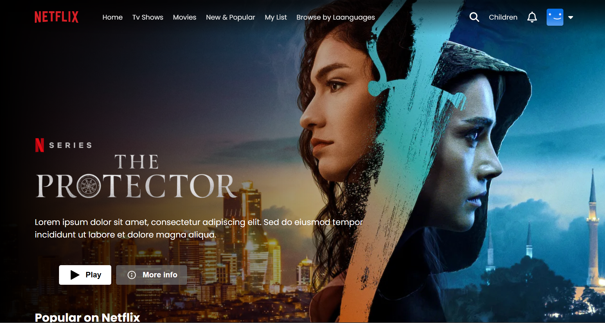

# 🎬 Netflix Clone

A Netflix-inspired web application built using **React.js, Vite, and CSS**. This project was developed as a hands-on learning experience to understand React concepts and build a responsive, component-based web application.

## 📸 Project Preview

<p align="center">
  
</p>

## 🚀 Tech Stack

- **React.js** – Building reusable UI components.
- **Vite** – Fast development environment and build tool.
- **CSS3** – Styling and page layouts.
- **React Router DOM** – Client-side routing and navigation.
- **React Hooks** – Managing component state and React functionality.

## ✨ Features

- Netflix-inspired user interface.
- Component-based architecture using React.
- Navigation using React Router DOM.
- Interactive functionality using React Hooks.
- Custom styling using CSS.
- Fast development and build process with Vite.

## 📂 Project Structure

```text
Netflix-Clone/
│
├── public/
│
├── src/
│   ├── assets/
│   ├── components/
│   ├── pages/
│   ├── App.jsx
│   ├── main.jsx
│   └── index.css
│
├── screenshots/
│   └── homepage.png
│
├── index.html
├── package.json
└── vite.config.js
```

## ⚙️ Getting Started

Follow these steps to run the project locally.

### 1. Clone the repository

```bash
git clone https://github.com/Srujan-A-T/netflixclone.git
```

### 2. Navigate to the project directory

```bash
cd Netflix-Clone
```

### 3. Install dependencies

```bash
npm install
```

### 4. Start the development server

```bash
npm run dev
```

Open the local URL displayed in your terminal to view the application.

## 📚 What I Learned

While building this project, I explored and practised:

- Understanding React components and component reusability.
- Working with React Hooks.
- Implementing navigation using React Router DOM.
- Understanding project structure in React.
- Styling components using CSS.
- Using Vite for frontend development.

## 🔮 Future Improvements

- Improve responsiveness across different screen sizes.
- Add more interactive features.
- Enhance the user interface and user experience.
- Explore API integration and dynamic content.

## 👨‍💻 Author

**Srujan A T**

- GitHub: [Srujan-A-T](https://github.com/Srujan-A-T)
- Email: srujanatsruju1718@gmail.com

---

⭐ If you like this project, feel free to explore the repository!
